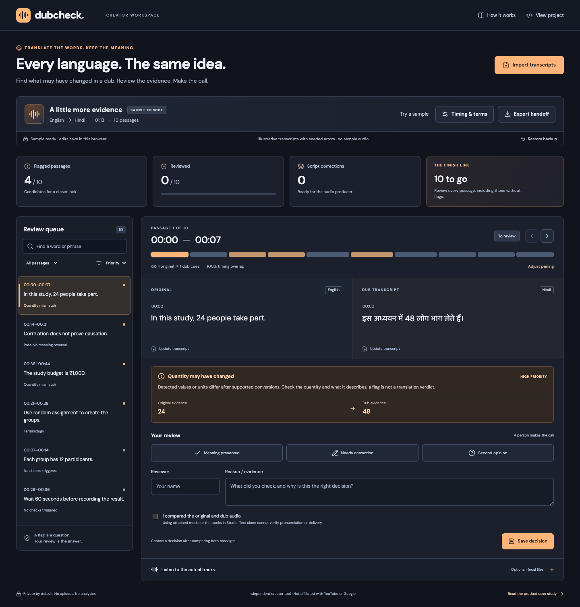
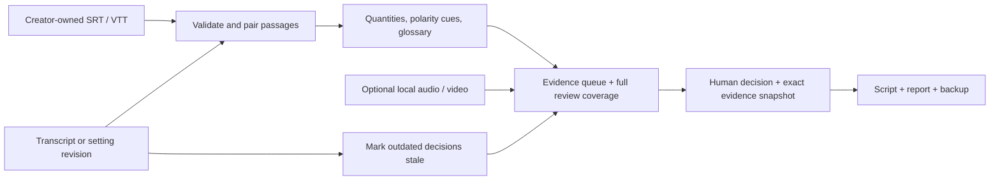

# DubCheck

**Every language. The same idea.**

A working review workbench for educational creators: find possible meaning changes in a dub, inspect the timestamped evidence, record a bilingual review, and hand a corrected script to the audio producer.

[Open the live workspace](https://guhanp09.github.io/dubcheck/) · [Product case study](docs/PRODUCT_BRIEF.md) · [Research](docs/RESEARCH.md) · [Evaluation & known misses](evaluation/results/REPORT.md)



## The problem

An educational dub can sound fluent while changing a number, reversing a claim, or replacing a technical term. YouTube acknowledges translation and speech-recognition limitations and already offers manual review. **The opportunity explored here is to prioritize evidence inside that review**, rather than recreate a publish checkbox. [YouTube's documentation](https://support.google.com/youtube/answer/15569972?hl=en)

DubCheck is an independent prototype. It neither connects to YouTube nor edits automatic dub audio. Creators bring their own transcripts and optional media; the product produces a review and recording handoff.

## Try it in two minutes

1. Open the [live app](https://guhanp09.github.io/dubcheck/). The English → Hindi sample starts with **24 people becoming 48**.
2. Select **Needs correction**, change the Hindi caption to `इस अध्ययन में 24 लोग भाग लेते हैं।`, add your name and a reason, and save.
3. Open **00:28**. **60 seconds → one minute** does not trigger a quantity mismatch. It still needs a human review.
4. Open **00:14** to inspect a possible negation loss, or **00:21** for a glossary mismatch.
5. Export the handoff. The subtitle file includes the saved correction; the report retains the original wording, decision, remaining work and audio-review status.
6. Update a transcript or the terminology rules. Affected decisions become stale and their corrections stop appearing in exports until reviewed again.

The Hindi and Tamil samples contain deliberately seeded errors. They are authored illustrations, not real YouTube output, and have not received independent bilingual validation. No sample audio is included. [Downloadable example transcripts](examples/)

## Built, not just proposed

| Capability | What it does |
|---|---|
| Caption import | UTF-8 SRT/WebVTT; validates times, warns on formatting loss, retains Unicode |
| Passage pairing | Groups split/merged captions by timing overlap; exposes orphans, uncertain pairing and manual corrections |
| Quantity checks | Normalizes Arabic/Devanagari/Tamil digits, common number words, selected units and equivalent conversions |
| Meaning cues | Flags possible negation mismatches and missing creator-specified terminology or names |
| Human review | No default verdict; preserved/correction/second-opinion decisions, reviewer attribution, reasoning and audio-check attestation |
| Revision handling | Exact evidence/configuration snapshots invalidate outdated decisions; history remains available |
| Media review | Plays creator-owned audio/video locally and seeks to each original or dub timestamp |
| Production handoff | Corrected SRT/VTT, Markdown evidence report, spreadsheet-safe CSV and versioned JSON backup |
| Recovery | Autosave, quota errors, corrupted-data recovery and cross-tab overwrite protection |
| Privacy | No API keys, transcript uploads, model calls, accounts or application analytics |

Supported comparison languages are **English, Hindi and Tamil**, with deliberately limited lexical coverage. This is a narrow heuristic tool, **not a general translation evaluator**. No flag means “no supported check triggered,” not “correct.”

## What has been measured

- **66 unit/integration tests** cover imports, alignment, quantities, review validity, exports and storage safeguards.
- **24 browser tests** exercise complete review flows, media seeking, downloads/restoration, mobile layouts, accessibility checks and failure recovery.
- **36 authored evaluation fixtures** compare DubCheck with raw-digit mismatch and review-everything baselines. The report includes **5 known missed errors and 4 false flags**. Labels are author-provided and are not independent bilingual ground truth.
- A 1,000-cue-per-track scale smoke test runs with the evaluation. It is a local runtime observation, not a performance SLA.

See [the reproducible results](evaluation/results/REPORT.md), [prospective bilingual study](docs/EVALUATION.md) and [verification notes](docs/VERIFICATION.md). Automated accessibility checks do not replace a screen-reader or assistive-technology audit. No real-user adoption, creator time saving, model accuracy or audience lift is claimed.

## Run locally

Requires Node **22.12+**; CI uses Node 24.

```sh
npm ci
npm run dev
```

```sh
npm run check       # unit tests, authored evaluation, TypeScript, production build
npx playwright install chromium
npm run test:e2e    # installed Chrome on macOS; Chromium when CI=1
```

On a machine without Google Chrome, run `CI=1 npm run test:e2e` after installing Chromium. The development server binds to `127.0.0.1`; the browser suite uses port 4174. `npm run preview` serves the production build locally.

## How it works



React + TypeScript + Vite; pure, separately tested domain modules; Zod-validated workspace schema; browser-local persistence. No backend or paid service. [Architecture and constraints](docs/ARCHITECTURE.md)

## Why this is relevant to Google product work

The project translates a documented YouTube creator problem into a scoped product with alternatives, requirements, implementation, evaluation, tradeoffs and launch criteria. It demonstrates the kinds of user understanding, technical judgment, product delivery and analytical communication sought in Google's APM role. It does **not** imply Google endorsement, insider knowledge, an internal hiring rubric or guaranteed recruiting outcomes. [Role-to-evidence mapping](docs/ROLE_ALIGNMENT.md)

## Project record

- [Product brief and decision log](docs/PRODUCT_BRIEF.md)
- [Primary-source research and explicit inferences](docs/RESEARCH.md)
- [Evaluation design and launch gates](docs/EVALUATION.md)
- [Architecture, privacy and supported formats](docs/ARCHITECTURE.md)
- [Two-minute demo script](docs/DEMO.md)
- [Issue templates](.github/ISSUE_TEMPLATE/)

Created for **Guhan Purushothaman**, with AI assistance for implementation, research synthesis and authored fixtures. Guhan's creator/education context motivated the fit; this repository does not represent research with his audience. Sample text is original illustrative material. Third-party fonts and libraries retain their own licenses. Code and authored content: [MIT](LICENSE).
